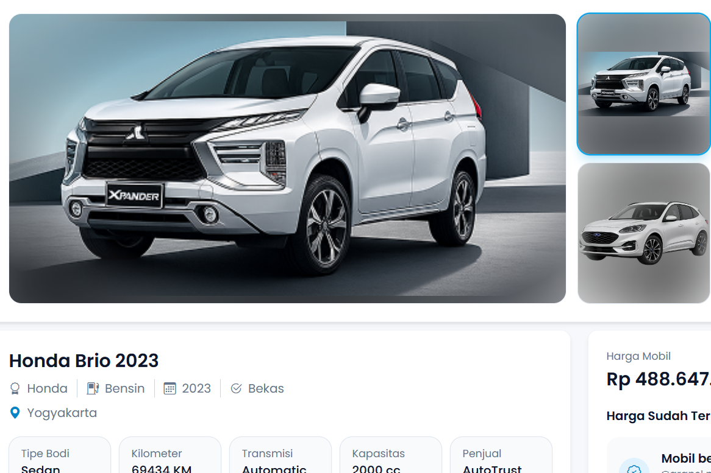

# Auto Trust

Auto Trust is a vehicle sales and rental catalog application built with Laravel. It includes car and motorcycle listings, seller profiles, reviews, favorites, vehicle requests, and messaging between users.

**Status:** Local development; a public demo is not yet available.

## Preview

[](docs/screenshots/project-preview.png)

## Features

- Car and motorcycle listings for sale or rent
- Vehicle details and image galleries
- Seller profiles and account settings
- Vehicle reviews and favorites
- Vehicle request posts
- Articles and company information
- Messaging between registered users

## Technology

- Laravel 12 and PHP
- Blade templates and Alpine.js
- Tailwind CSS and Vite 7
- MySQL
- JavaScript for frontend interactions and chat polling

## Requirements

| Component | Requirement |
| --- | --- |
| PHP | PHP 8.2 or newer within the PHP 8 series |
| Composer | Composer 2 |
| Node.js | Node 22.12+ or 24.x; Vite 7 requires `^20.19.0 || >=22.12.0` |
| Package manager | npm |
| Database | MySQL with a dedicated local development database |
| Browser | A modern browser with JavaScript enabled |
| Git | Optional when downloading the source as a ZIP |

Enable the PHP extensions required by Laravel and the installed dependencies, including Ctype, cURL, DOM/XML, Fileinfo, Filter, Hash, Mbstring, OpenSSL, PCRE, PDO, PDO MySQL, Session, and Tokenizer. ZIP support is useful for extracting Composer packages.

The automated test configuration uses SQLite, so enable PDO SQLite when running tests.

Check your terminal tools:

```sh
php -v
php -m
composer --version
node --version
npm --version
```

After installing dependencies, use `composer check-platform-reqs` to verify their PHP requirements.

### Windows with XAMPP

XAMPP can provide PHP and MySQL.

1. Start MySQL from the XAMPP Control Panel.
2. Add the PHP directory, such as `C:\xampp\php`, to your user `PATH`.
3. Install Composer and Node.js separately if they are not already available.
4. Reopen your terminal after updating `PATH`.

Apache is optional when running the application with `php artisan serve`.

Use `php --ini` to locate the configuration file used by CLI PHP. It may differ from the configuration used by Apache.

## 1. Download the source

Clone the repository:

```sh
git clone https://github.com/bagus-mahmudie/auto-trust.git
cd auto-trust
```

Alternatively:

1. Select **Code → Download ZIP** on GitHub.
2. Extract the archive.
3. Open a terminal in the extracted directory containing `artisan`, `composer.json`, and `package.json`.

Run the following commands from this project directory unless stated otherwise.

## 2. Create the environment file

Copy `.env.example` to `.env`.

Windows PowerShell:

```powershell
Copy-Item .env.example .env
```

macOS/Linux:

```sh
cp .env.example .env
```

Do this only for a new installation. Do not overwrite an existing `.env` containing your configuration.

The `.env` file contains local settings and credentials. Keep it private and do not commit it to Git.

## 3. Create and configure the database

Create a new, empty database named `auto_trust` through phpMyAdmin or your MySQL client.

Example SQL:

```sql
CREATE DATABASE auto_trust
CHARACTER SET utf8mb4
COLLATE utf8mb4_unicode_ci;
```

Edit the database settings in `.env`:

```dotenv
APP_NAME="Auto Trust"
APP_ENV=local
APP_DEBUG=true
APP_URL=http://localhost:8000

DB_CONNECTION=mysql
DB_HOST=127.0.0.1
DB_PORT=3306
DB_DATABASE=auto_trust
DB_USERNAME=your_local_mysql_user
DB_PASSWORD="your_local_mysql_password"

SESSION_DRIVER=file
SESSION_DOMAIN=null
CACHE_STORE=file
CACHE_DRIVER=file
QUEUE_CONNECTION=sync
MAIL_MAILER=log
```

Replace the database username and password with your own local credentials. If your local MySQL account has no password, use:

```dotenv
DB_PASSWORD=
```

The database account must have permission to create and modify tables in the development database.

Keep the other values from `.env.example` unless you need to change them.

With these defaults:

- Sessions and cache use local files.
- Queued jobs execute synchronously.
- Email is written to the application log.
- Redis and a separate queue worker are not required for the initial setup.

## 4. Install dependencies

```sh
composer install
composer check-platform-reqs
npm ci
```

These commands install the versions recorded in `composer.lock` and `package-lock.json`.

Internet access is normally required for the first installation. Keep development dependencies installed if you want to run the sample seeder or automated tests.

## 5. Initialize the application

```sh
php artisan key:generate
php artisan migrate
php artisan storage:link
```

These commands:

- Generate a unique encryption key for your installation.
- Create the database tables.
- Link `public/storage` to the public upload directory.

Check your database configuration before running migrations.

Generate the application key once for a new installation. Do not regenerate it routinely on an existing application.

## 6. Optional sample data

You can skip this step and create your own account and listings through the application.

For a disposable development database, the repository includes sample vehicle data:

```sh
php artisan db:seed
```

`DatabaseSeeder` runs `KendaraanSeeder`, which creates:

- 20 car sale listings
- 20 motorcycle sale listings
- 20 car rental listings
- 20 motorcycle rental listings

### Important: seeding deletes existing catalog data

Before creating sample listings, the current seeder truncates these tables:

- `mobil_likes`
- `motor_likes`
- `reviews`
- `motor_reviews`
- `messages`
- `mobil_sewa`
- `motor_sewa`
- `mobil`
- `motor`

**Run this seeder only on a disposable local database.** Repeating it deletes existing records in those tables, including messages, reviews, favorites, and vehicle listings.

The seeder uses MySQL-specific statements to disable and re-enable foreign-key checks. Use the MySQL configuration described in this guide when seeding.

### Sample account behavior

The seeder ensures that a user with ID `1` exists. If that user does not exist, it creates a sample account with a randomly generated password.

There is no published default login password. Register your own account through the application instead.

If user ID `1` already exists, the seeder uses that user for its sample data.

### Sample vehicle images

The seeder looks for local images in:

```text
storage/app/public/mobil/
storage/app/public/motor/
```

If no suitable images are found, it references:

```text
mobil/default.png
motor/default.png
```

Original uploads are not included in the repository. To display sample images, either:

- Add your own images to the corresponding folders before running the seeder; or
- Provide `default.png` in each folder as a fallback.

Run `php artisan storage:link` so these files can be accessed through `/storage/`.

Missing upload files can cause broken images even when the database records were created successfully.

## 7. Build and start the application

Build the frontend:

```sh
npm run build
```

Start Laravel:

```sh
php artisan serve --host=localhost --port=8000
```

Open:

[http://localhost:8000](http://localhost:8000)

Keep the terminal running. Press `Ctrl+C` to stop the server.

Use the same hostname consistently. Switching between `localhost` and `127.0.0.1` can affect sessions and cookies.

### Frontend development

For automatic frontend rebuilding, keep Laravel running and open a second terminal in the project directory:

```sh
npm run dev
```

Continue browsing the application at `http://localhost:8000`. Vite runs a separate asset server; its URL is not the main application URL.

When finished:

1. Stop Vite with `Ctrl+C`.
2. Run `npm run build` to generate the frontend bundle.

If Vite was interrupted and the application still requests its old address, check for a stale generated `public/hot` file. Remove it only after confirming that Vite is stopped.

## 8. Create your own account

1. Open the homepage.
2. Open the login/register modal.
3. Select registration.
4. Enter your name, a lowercase email address, a password, and password confirmation.
5. Submit the form.

The current registration controller signs the user in after successful registration. The current user model does not implement Laravel's email-verification contract, so there is no required email OTP step in this registration flow.

Use the password you selected when registering. The sample seeder account is not intended to provide a shared login.

Auto Trust uses its own user and seller flows. This guide does not require creating a Catkuji-style `admin` or `super_admin` role.

## 9. Explore the local application

| Page | Path |
| --- | --- |
| Homepage | `/` |
| Car catalog | `/rekomendasi-mobil` |
| Motorcycle catalog | `/rekomendasi-motor` |
| Account settings | `/pengaturan` |
| Your seller profile | `/profil` |
| Create a car listing | `/jual-mobil` |
| Create a motorcycle listing | `/jual-motor` |
| Create a vehicle request | `/posting-kebutuhan` |
| Browse vehicle requests | `/butuh-mobil` |
| Articles | `/artikel` |
| Messages | `/chat` |

Account settings, your seller profile, listing creation, vehicle request creation, and chat require authentication.

For messaging checks, create a second local account in another browser or private window. The chat interface uses HTTP polling; a separate WebSocket service is not required by the current chat implementation.

An empty article or catalog page may simply mean that no corresponding content has been created. The vehicle seeder does not populate every feature.

## Email and optional services

### Local email logs

The default setting is:

```dotenv
MAIL_MAILER=log
```

Any mail generated by the application is written to:

```text
storage/logs/laravel.log
```

It is not delivered to an inbox.

Read recent log entries in PowerShell:

```powershell
Get-Content storage/logs/laravel.log -Tail 100
```

Or on macOS/Linux:

```sh
tail -n 100 storage/logs/laravel.log
```

### SMTP delivery

If you need actual email delivery, configure your own SMTP service in `.env`:

```dotenv
MAIL_MAILER=smtp
MAIL_HOST=your_smtp_host
MAIL_PORT=587
MAIL_USERNAME=your_smtp_username
MAIL_PASSWORD="your_smtp_password"
MAIL_FROM_ADDRESS=your_sender@example.com
MAIL_FROM_NAME="${APP_NAME}"
```

Use the port and transport settings supported by your provider and `config/mail.php`.

After changing configuration:

```sh
php artisan config:clear
```

Restart any long-running processes that use the changed settings.

### Other services

The initial local setup does not require payment, shipping, or OAuth credentials.

Redis and AWS settings in `.env.example` are optional infrastructure settings. Leave them unused unless you explicitly configure the application to use those services.

## Verify your installation

Check the following manually:

1. The homepage opens with styles and working JavaScript.
2. Registration and login work with your own account.
3. Catalog pages load.
4. Seeded listings appear if you chose to seed the database.
5. Your account settings and seller profile open.
6. A listing can be created with an image you provide.
7. Favorites and messaging work between your local test accounts.

Useful diagnostic commands:

```sh
php artisan migrate:status
php artisan route:list
```

For automated checks:

```sh
php artisan config:clear
php artisan test
npm run build
```

The supplied PHPUnit configuration uses an in-memory SQLite database. Enable PDO SQLite before running tests, and ensure shell-level database settings do not override the intended test configuration.

The vehicle seeder is MySQL-specific and should not be assumed to work in SQLite tests.

These are verification steps to run on your machine, not a statement that every feature has already passed testing on every environment.

## Working on an existing installation

Before applying updated source code, back up any local database or uploads you want to preserve.

When dependency lock files or migrations have changed, review those changes and run the appropriate commands:

```sh
composer install
npm ci
php artisan migrate
npm run build
php artisan config:clear
```

Do not overwrite your existing `.env`, regenerate `APP_KEY`, or rerun the destructive vehicle seeder as part of a routine update.

## Repository notes

Installed dependencies, private environment files, operational databases, and original user uploads are not included.

Use your own development database, accounts, and credentials. Keep `.env`, logs, and database exports out of Git.

This guide covers local development. Public hosting requires separate deployment configuration, a web document root pointing to `public/`, and `APP_DEBUG=false`.

Brand names and third-party assets remain subject to their respective owners' rights. This repository does not grant a license for reuse.
